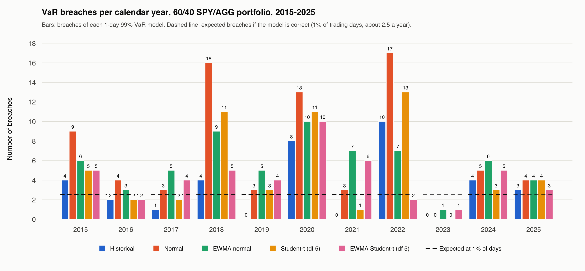
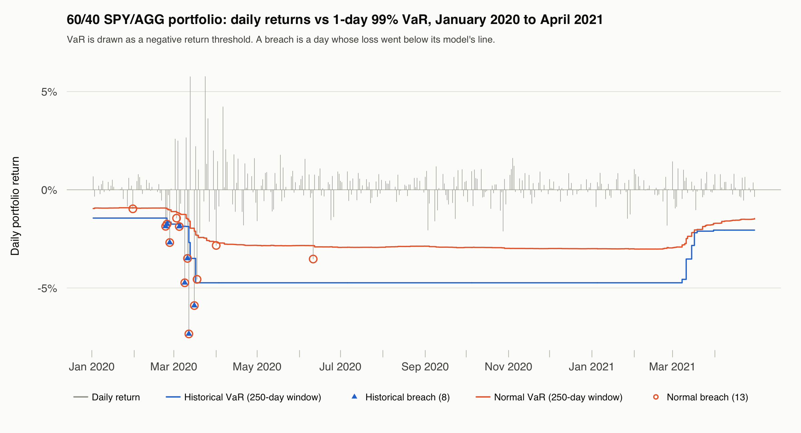
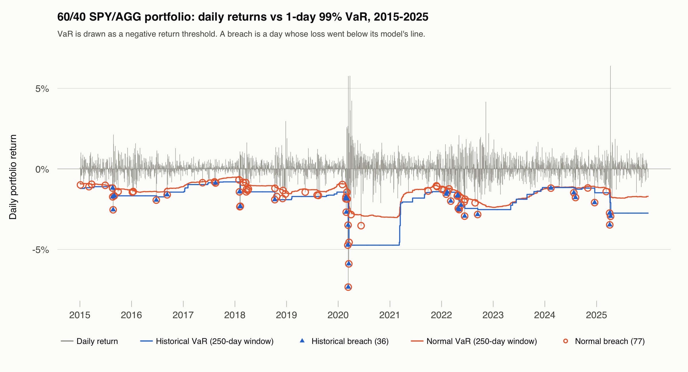
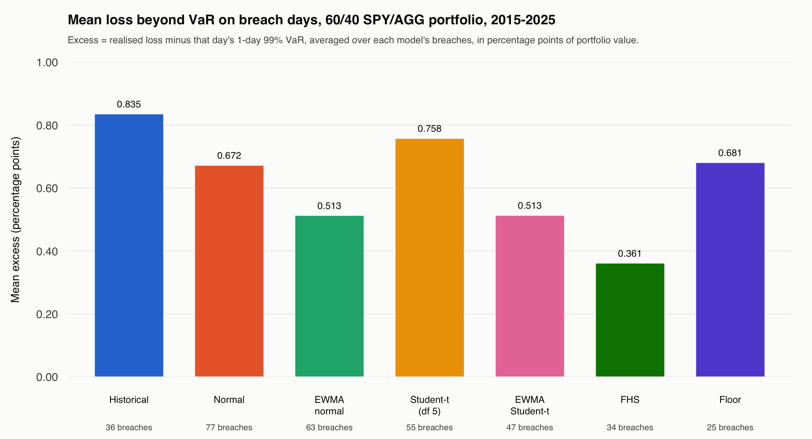
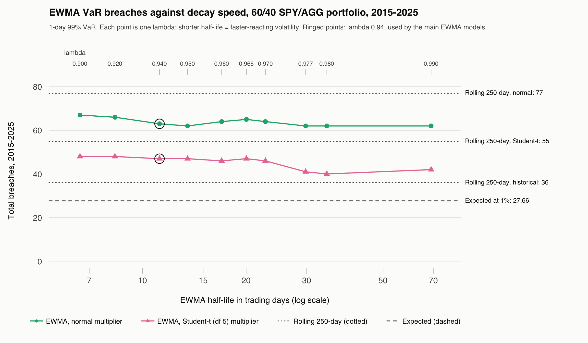

# var-backtest

## Summary

We forecast the 1-day 99% VaR of a 60/40 stock and bond portfolio with
seven models and backtested them over 2,766 trading days (2015 to 2025).
The breach count alone hides how models fail, and no model passed every
test. Filtered historical simulation (FHS) did best on breach count,
breach size and clustering, but it still failed the independence test.

## Setup

- **Portfolio:** 60% SPY and 40% AGG, rebalanced daily.
- **Forecasts:** 2,766 trading days from 2015-01-02 to 2025-12-31, each
  using only earlier data. Built in R with prices from Yahoo Finance.
- **What a correct model looks like:** breaches follow a binomial
  distribution, so we expect 27.66, give or take about 5.2, and a breach
  yesterday should say nothing about today. At the same breach rate, a
  lower average VaR is more efficient and smaller breaches are better.

## Method

### Models

First, we try to estimate VaR with a rolling window of the last 250 trading
days, with different tail forms.

- **Historical:** use the third-worst return in the past 250 trading days.
- **Normal:** assume the returns are normally distributed, estimate the mean
  and SD from the window, and compute the tail with the normal multiplier.
- **Student-t:** assume the returns are Student-t distributed, estimate the
  mean and SD from the window, and compute the tail with the t multiplier
  (5 degrees of freedom).

For quicker reaction, EWMA volatility was introduced, in which today's
variance = 0.94 × yesterday's variance + 0.06 × yesterday's squared return,
giving about half of the weight to the last 11 days.

- **EWMA normal:** EWMA volatility with the normal multiplier.
- **EWMA t:** EWMA volatility with the t multiplier (5 degrees of freedom).
- **FHS:** integrate historical and EWMA. Standardise each past day's return
  by dividing it by the EWMA volatility that was forecast for that day. Take
  the third-worst standardised return of the last 250 days as the
  multiplier. Today's VaR = that multiplier × today's EWMA volatility.
- **Floor:** simply take the larger of the EWMA normal VaR and the
  historical VaR each day.

### Technical details

- **Returns:** daily simple total returns from Yahoo's dividend-adjusted
  closing prices. The portfolio return is 0.6 × SPY + 0.4 × AGG every day,
  which is what daily rebalancing means.
- **VaR and breaches:** VaR is a positive number, a loss as a share of
  portfolio value. Day t is a breach when its loss is strictly larger than
  its VaR: −r_t > VaR_t. The forecast for day t uses returns up to day t−1
  only.
- **Quantile definition:** the historical VaR is R's `quantile(type = 1)`,
  the inverse of the empirical distribution function: the smallest return
  r for which at least 1% of the window is at or below r. With 250 returns,
  250 × 0.01 = 2.5 rounds up to 3, so VaR is minus the 3rd worst return.
  R's default (type 7) would interpolate between the 3rd and 4th worst. FHS
  uses the same rule on the standardised returns: its multiplier is minus
  the 3rd worst of the 250.
- **Parametric models:** VaR = multiplier × SD − mean, with the sample SD
  (n − 1). The normal multiplier is `qnorm(0.99)` = 2.326. The t multiplier
  is `-qt(0.01, 5) * sqrt(3/5)` = 2.606: the t quantile rescaled to unit
  variance, so it multiplies the same SD as the normal model. The EWMA
  models take the mean as zero.
- **EWMA start-up:** the EWMA variance is seeded with the sample variance
  of the first 250 returns (from 2013-06-04) and used from 2014-06-02. That
  is 149 trading days before the first forecast, so the seed's remaining
  weight is about 1e-4.
- **FHS start-up:** the first FHS forecast (2015-01-02) needs standardised
  returns from 2014-01-06, before the main EWMA starts. The standardised
  returns therefore use the same λ = 0.94 recursion seeded earlier, on the
  sample variance of the first 50 returns. From the first forecast date on,
  its volatility is within 1.7e-5 (relative) of the main EWMA. Today's
  volatility in the FHS formula is the main EWMA's, the same one the EWMA
  models use.

### Tests

All tests use a 5% significance level.

- **Kupiec (1995) proportion of failures:** likelihood ratio of the
  observed breach rate x/n against 1%, chi-squared with 1 degree of
  freedom. Under a correct model the count is Binomial(2,766, 0.01): mean
  27.66, standard deviation 5.23.
- **Christoffersen (1998) independence:** from the transition counts
  n00, n01, n10, n11 of the daily breach indicator (yesterday → today), it
  compares P(breach | no breach yesterday) = n01 / (n00 + n01) with
  P(breach | breach yesterday) = n11 / (n10 + n11). Likelihood ratio,
  chi-squared with 1 degree of freedom. If n11 = 0, the term 0 × log(0) is
  taken as 0; no model has n11 = 0 here.
- **Conditional coverage:** Kupiec LR + independence LR, chi-squared with
  2 degrees of freedom.
- **Clustering share:** the share of a model's breaches that came 1 to 5
  trading days after its previous breach. For independent breaches at 1%
  it is about 1 − 0.99^5 = 4.9%.
- **Severity:** excess = loss − VaR on breach days, in percentage points of
  portfolio value; mean, median, largest and total per model.
- **Sensitivity checks:** EWMA λ of 0.90, 0.92, 0.94, 0.95, 0.96, 0.966,
  0.97, 0.977, 0.98 and 0.99 (half-lives of 6.6 to 69 days) with both
  multipliers; t degrees of freedom of 4, 5 and 8; and an out-of-sample
  check that chooses λ on 2015-2019 (breaches closest to expected) and
  tests it on 2020-2025.

## Results

One row per model, 2,766 forecast days, 27.66 breaches expected
(`output/final_summary.csv`). Average VaR is in % of portfolio value;
excess is in percentage points.

| Model | Breaches | Kupiec p | Independence p | Conditional coverage p | Share clustered | Average VaR | Mean excess (pp) | Total excess (pp) |
|---|--:|--:|--:|--:|--:|--:|--:|--:|
| Historical | 36 | 0.128 | 3.8e-6 | 7.2e-6 | 47.2% | 1.92% | 0.84 | 30.1 |
| Normal | 77 | 1.0e-14 | 2.5e-4 | 1.2e-16 | 41.6% | 1.46% | 0.67 | 51.8 |
| Student-t (df 5) | 55 | 4.1e-6 | 8.2e-6 | 1.2e-9 | 45.5% | 1.64% | 0.76 | 41.7 |
| EWMA normal | 63 | 7.1e-9 | 0.016 | 3.0e-9 | 20.6% | 1.39% | 0.51 | 32.3 |
| EWMA Student-t (df 5) | 47 | 7.8e-4 | 1.1e-3 | 1.7e-5 | 23.4% | 1.56% | 0.51 | 24.1 |
| FHS | 34 | 0.242 | 6.2e-4 | 1.5e-3 | 17.6% | 1.94% | 0.36 | 12.3 |
| Floor | 25 | 0.605 | 1.3e-6 | 7.3e-6 | 32.0% | 2.00% | 0.68 | 17.0 |


*Breaches per calendar year for all seven models, against the expected 2.5 a year.*


*Daily returns against the historical, normal and EWMA normal VaR from January 2020 to April 2021, with breaches marked.*


*Daily returns against the historical and normal VaR over the full period, with breaches marked.*


*Mean loss beyond VaR on breach days, per model.*


*Total breaches against EWMA half-life for the normal and t multipliers, with the rolling-window models as reference lines.*

## Findings

### 1. Do the models produce the right number of breaches?

Three models pass the Kupiec count test: historical (36 breaches), FHS
(34) and floor (25). The other four are rejected: normal (77), Student-t
(55), EWMA normal (63) and EWMA t (47). Historical VaR was above normal
VaR on 96% of days.

### 2. Why is the count not enough?

The historical model passes on the total, but its breaches come at the
wrong times: 8 in 2020 and 10 in 2022, and none in 2019, 2021 or 2023.
On 16 March 2020 the portfolio lost 5.90%. The historical VaR (3.50%) and
the normal VaR (2.11%) were both breached, while the EWMA normal VaR stood
at 6.68% and held. Breach size differs too: the largest loss beyond VaR
was 4.65 points for the historical model and 1.11 for FHS.

### 3. Fat tails or reaction speed?

Starting from the normal model's 77 breaches, the t multiplier (about 12%
higher) removed 22 and EWMA volatility removed 14. Both together left 47,
still rejected. EWMA works in a crisis, but it forgets turbulence within
weeks, so in calm periods a moderately bad day becomes a breach, and its
short memory makes the estimate noisier.

Changing the EWMA half-life between 6 and 69 days changed little: 62 to
67 breaches with the normal multiplier, and at best about 40 with the t
multiplier, near a 30-day half-life. Using 4 degrees of freedom instead
of 5 changed the count by one. In an out-of-sample check, selecting on
2015 to 2019 produced a three-way tie, and the verdict on 2020 to 2025
depended on the tie-break (28 breaches, rejected; 22 to 23, not
rejected). The benefit of a longer half-life is therefore not established.

### 4. Which model did best, and what does it still get wrong?

FHS combines EWMA's sensitivity to recent data with a tail taken from the
data. It had 34 breaches at almost the same average VaR as the historical
model (1.94% against 1.92%), with total excess about 60% lower (12.3
against 30.1). Its largest excess was 1.11 points, against 2.37 to 5.74
for the other models. Its data-implied multiplier had a median of 3.06,
against 2.33 for the normal and 2.61 for the t, and ranged from 1.87 to
4.30, so no fixed multiplier could be right.

The floor model has the fewest breaches (25) but the highest average VaR
(2.00%), and it inherits the historical model's zero-breach years. Its
total excess (17.0) is the second lowest.

All seven models fail the independence test. The share of breaches within
5 days of a previous one is 42% to 47% for the rolling models, 32% for
the floor model and 18% to 23% for the EWMA-based models, against about
5% for an independent model. After the 3.5% loss on 11 March 2020, EWMA
volatility rose only from about 1.76% to 1.91%, and the next day the
portfolio lost 7.3%. A new shock gets only 6% of the weight, which is too
slow when a crisis escalates from one day to the next.

## Limitations

- **One history, many attempts:** we tried seven models and twenty EWMA
  settings on one portfolio and one period, so the "best" model here may
  not be the best elsewhere.
- **Few breaches:** with 27.66 expected and natural variation of about
  ±5, a correct model's count can fall anywhere from roughly 18 to 38.
  The Kupiec test cannot separate a correct model from a moderately
  miscalibrated one.
- **Independence test:** it only looks at consecutive days, so we also
  report the share within 5 days. Its p-values rest on 4 to 9 breach
  pairs per model and are approximate, although the gap between observed
  and expected is large.
- **Data:** prices come from Yahoo Finance, an unofficial source.

## How to run

You need R 4.6.1 (the version in `renv.lock`) and an internet connection.
Price data is not stored in the repository; the first run downloads it
from Yahoo Finance.

```sh
git clone https://github.com/Padisarah789/var-backtest.git
cd var-backtest
Rscript -e 'renv::restore(prompt = FALSE)'   # install the locked package versions
Rscript run_all.R                            # download prices, forecast, backtest, charts
```

`run_all.R` downloads the prices only if `data/raw/` is empty; use
`REFRESH=1 Rscript run_all.R` to download them again. Yahoo revises its
adjusted prices from time to time, so a fresh download can move the
results slightly.

The run prints the data quality report, the hand checks for single dates,
and every backtest table, and it writes:

- `output/`: the tables (`final_summary.csv`, `backtest_*.csv`,
  `ewma_lambda_*.csv`), plus `var_forecasts.csv` and `quality_report.txt`,
  which are not committed;
- `figures/`: the charts.

## Repository structure

```
var-backtest/
├── run_all.R               runs the whole pipeline
├── R/
│   ├── config.R            tickers, weights, dates, window, VaR level
│   ├── download.R          downloads SPY and AGG prices from Yahoo
│   ├── returns.R           daily returns and the 60/40 portfolio
│   ├── var_models.R        the seven VaR models
│   ├── backtest.R          breaches, Kupiec, Christoffersen, severity, summary tables
│   ├── ewma_sensitivity.R  EWMA lambda sensitivity and out-of-sample check
│   ├── charts.R            the charts in figures/
│   ├── quality_report.R    data checks
│   └── hand_check.R        printouts for checking single dates by hand
├── data/raw/               downloaded prices (not committed)
├── output/                 result tables
├── figures/                charts
├── renv.lock, renv/        locked package versions
├── PLAN.md                 work log and next steps
└── README.md
```
